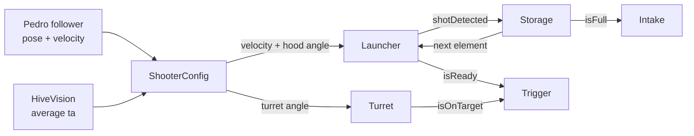

# Sharp Face Robotics #30450 — BioBuzz (2026–27)

Robot code for FTC team **Sharp Face Robotics #30450**. Built on the FTC SDK 11.2,
[Pedro Pathing 3](https://pedropathing.com) for driving and localization, and
[Panels](https://panels.bylazar.com) for live tuning.

> The stock FTC SDK readme now lives in [doc/FTC_SDK_README.md](doc/FTC_SDK_README.md).

## Layout

```
TeamCode/src/main/java/org/firstinspires/ftc/teamcode/
├── robot/                  subsystems: one class per mechanism
│   ├── RobotHardware       every motor/servo/sensor + Pedro follower
│   ├── RobotConfig         every constant and tunable (live-editable in Panels)
│   ├── Drivetrain          field/robot-centric mecanum through Pedro
│   ├── Intake              roller, auto-stop when full, jam detection
│   ├── Storage             tracks which elements are inside, in order
│   ├── ShooterConfig       distance → flywheel speed + hood angle, shoot-on-the-move
│   ├── Launcher            flywheel (velocity / PF / bang-bang) + hood
│   ├── Turret              CR servo turret, hall-effect homing, cable unwinding
│   ├── Trigger             gate + feeder, only fires when shooter and turret are ready
│   ├── HiveVision          Limelight AprilTag: averaged ta + MegaTag2 relocalization
│   ├── ElementVision       Limelight detector: finds pollen/nectar on the field
│   ├── PoseStorage         carries the pose from auto into TeleOp
│   └── helperClasses/      FieldGeometry (BIOBUZZ field), HiveTracker, InterpLUT, MotionProfile,
│                           ShotDetector, FieldDrawing, MatchLogger, ValueTuner
├── teleop/                 TeleopBase + CompTeleopRed/Blue, pit test + tuning OpModes
├── auto/                   AutoBase + Subordinate / Parallel Inside / Parallel Outside autos
└── pedro/                  Pedro Constants (follower setup) + tuning procedures
tools/analyze_matchlog.py   turns match logs into cycle times, bottlenecks, battery/loop health
doc/PORTFOLIO_SOFTWARE.md   draft of the portfolio's software section
```

## BIOBUZZ in the code

Field data comes from the Competition Manual (sections 9–11). It's in
`robot/helperClasses/FieldGeometry.java`.

- **Field frame:** inches, with the origin at the corner where the audience wall meets the red
  wall. +x points toward the blue wall, +y away from the audience. Heading 0 faces the blue wall.
  The field is **180° rotationally symmetric**, so blue = red rotated about the centre.
- **HIVE:** in the field centre. Each alliance has two CELLS, and only the **upward** one
  scores. Each HIVE TIP (20 pts) flips which one that is. `HiveTracker` follows it in three ways:
  - A **weight model**: hives are calibrated to tip at 8 POLLEN, or 3 POLLEN + 3 NECTAR
    (Event Field Setup Guide §12). The starting cell already holds 3 NECTAR, so **the 3rd
    pre-load tips it** and the 4th goes into the other cell.
  - The **AprilTags** under the cells (red 30–33 far / 34–37 audience, blue 38–41 audience /
    42–45 far), which catch tips our partner causes.
  - Driver 2's left bumper as a manual override.

  Firing pauses for 0.6 s after each tip while the hive swings, and auto passes the hive state
  to TeleOp.
- **Elements:** POLLEN is a yellow 2.8 in ball, NECTAR a red or blue 3.6 in ball. The hood gap
  is set by size, and storage tells them apart by hue.
- **Rules enforced in code:**
  - G407: storage caps at 4, and a 5th element is spat back out.
  - G408: the opponent's NECTAR is never counted and is ejected automatically.
  - G402: auto paths are checked to stay on our half (init warning plus a unit test).
  - G304: autos preload 4 POLLEN.
- **Timing:** TeleOp is 2:00. Controllers rumble at 60 s (FLOWERS open, G410) and 15 s (park).
  PARK means at least partly in your LOADING ZONE: 5 pts in auto and 5 in TeleOp.

## How the pieces fit

Subsystems never call each other. Each loop, the OpMode reads one subsystem's output and
passes it into the next one as a parameter:



One loop of `TeleopBase` / `AutoBase`:

1. `robot.clearBulkCache()`: one hub read for every sensor this loop
2. `follower.update()`, then read the pose and velocity
3. vision, storage, intake
4. `shooterConfig.calculateShootingConfig(...)`, then turret, then launcher
5. trigger fires only if `launcher.isReady() && turret.isOnTarget()`
6. a velocity dip on the flywheel (`launcher.shotDetected()`) removes one element from storage

## Coding protocol

From the team software doc:

- **Every subsystem looks like this.** It gets `RobotHardware` in the constructor and uses
  `robot.someMotor` directly. Never call `hardwareMap` or declare motors in a subsystem.
  ```java
  public class Intake {
      private final RobotHardware robot;
      public Intake(RobotHardware robot) { this.robot = robot; }
      public void runIntake() { robot.intakeMotor.setPower(RobotConfig.INTAKE_POWER); }
  }
  ```
- **No calling other subsystems.** The only allowed exceptions are `RobotConfig` constants
  and `RobotHardware`. Anything else comes in as a parameter. `RobotConfig` (and the static
  `PoseStorage`) don't use the constructor pattern.
- **No `Math.pow` for squares or cubes.** Write `x * x` or `x * x * x`.
- **No `new` inside the loop.** Create timers, arrays and the like once as fields. The loops
  in `TeleopBase` and `AutoBase` only allocate on a button press.
- **Git:** push work to `predevelopment`. Once it's tested on the robot, commit *your file*
  to `main` in a single commit. Never merge the whole branch, because others might not be done.

## Roles

| Area | Files | Owner |
|---|---|---|
| Drivetrain | `robot/Drivetrain.java`, `pedro/Constants.java` | Arnav |
| Robot hardware / config | `robot/RobotHardware.java`, `robot/RobotConfig.java` | Arnav |
| Launcher, shooter config, turret | `robot/Launcher.java`, `robot/ShooterConfig.java`, `robot/Turret.java` | Alex |
| Hive vision, element vision | `robot/HiveVision.java`, `robot/ElementVision.java` | Gautham |
| Storage, intake | `robot/Storage.java`, `robot/Intake.java` | Vibhav |
| Trigger (+ gate), pose storage | `robot/Trigger.java`, `robot/PoseStorage.java` | Ryan |
| Subordinate auto | `auto/SubordinateAutoBase.java` (+ Red/Blue) | Alex |
| Parallel autos (inside, outside) | `auto/ParallelAutoInsideBase.java`, `auto/ParallelAutoOutsideBase.java` (+ Red/Blue) | Vivek |
| TeleOp red/blue | `teleop/TeleopBase.java`, `teleop/CompTeleopRed.java`, `teleop/CompTeleopBlue.java` | Arnav |

## Robot configuration (Driver Station)

Names must match `RobotConfig` exactly:

| Device | Type | Name |
|---|---|---|
| Drive motors | goBILDA motor | `front_left_drive`, `back_left_drive`, `front_right_drive`, `back_right_drive` |
| Odometry | goBILDA Pinpoint | `pinpoint` |
| Intake | motor | `intake_motor` |
| Storage entry sensor | REV Color Sensor V3 | `storage_color` |
| Flywheel | motor | `launch_motor` |
| Hood angle | servo ×2 | `hood_angle_servo_1`, `hood_angle_servo_2` |
| Hood gap | servo ×2 | `hood_gap_servo_1`, `hood_gap_servo_2` |
| Turret | CR servo | `turret_servo` |
| Turret encoder | motor port (encoder only) | `turret_encoder` |
| Turret zero | REV magnetic limit switch (digital) | `turret_hall` |
| Feeder | motor | `trigger_motor` |
| Gate | servo | `gate_servo` |
| Camera | Limelight 3A | `limelight` |

Run **SubsystemTest** first on a new robot: it drives every mechanism by hand and shows
every sensor, so wiring mistakes show up before a match.

The shooter test OpModes (`ShooterTestPanels`, `FlywheelPFTuning*`) call
`robot.initLauncher()`, which only needs `launch_motor`, so they run on a bare shooter bench.

## TeleOp controls

| Driver 1 (gamepad1) | | Driver 2 (gamepad2) | |
|---|---|---|---|
| Left stick | drive | A | flywheel on/off |
| Right stick | turn | Right trigger (hold) | **fire** |
| Right bumper | slow mode | X | auto-fire on/off |
| Right trigger | intake | B | manual turret on/off (right stick X) |
| Left trigger | outtake | D-pad left/right | turret trim ±1° |
| A (hold) | aim chassis at hive | D-pad down | clear trim |
| B (hold) | **park assist:** drive into the LOADING ZONE | Y | re-home turret |
| X (hold) | **element assist:** turn toward the nearest legal element | | |
| Left bumper | snap pose to Limelight | Start | turret: call current spot zero (if homing fails) |
| Options | reset field-centric heading | Back | reset storage count |
| Back | field ↔ robot centric | Left bumper | "hive tipped": flip the target cell |

**Shooting modes:**
- **Auto spin-up:** the flywheel spins up whenever storage has elements in it
  (`AUTO_SPINUP_WHEN_LOADED`), so it's already at speed when you pull fire.
- **Auto-fire (X):** fires on its own whenever the robot is loaded, within
  `MIN/MAX_SHOT_DISTANCE`, and the shot is ready. Driver 2 just watches.
- **Turret down?** Press B for manual turret on driver 2's right stick, or have driver 1 hold
  A to turn the whole robot toward the hive. In both cases the driver judges the aim, so
  firing doesn't wait for the turret to report on target.

**On-screen stats and warnings:** shots fired, elements intaken and last cycle time, plus
warnings for low battery, a disconnected Limelight, a slow loop, or a match log that isn't writing.

**Match logs:** every TeleOp and auto writes a CSV of pose, flywheel, turret, storage and
firing to `/sdcard/FIRST/data/matchlogs/` on the Control Hub, at 20 Hz. Pull them with
`adb pull /sdcard/FIRST/data/matchlogs` or Android Studio's Device Explorer, then graph them
in a spreadsheet to see why a shot missed or where cycle time went.

**Feedback:** gamepad1 double-buzzes when storage fills. Gamepad2's light is **green** when a
shot is ready, **yellow** while the turret homes, and **red** if homing failed (press Start
with the turret pointing forward). Both controllers buzz at 60 s left (FLOWERS open) and 15 s left (time to park).

**Optional assists** (off by default until Pedro and the Limelight are tuned; turn on in `RobotConfig`):
- `LOCK_POSITION_WHILE_FIRING`: Pedro holds the robot in place while firing, so defense
  can't push it off the shot. Moving a stick cancels it.
- `AUTO_RELOCALIZE`: snap odometry to the Limelight whenever the robot is nearly stopped and
  they disagree by more than 2 in.

Panels shows all telemetry, plus a live field view with the robot, its heading, the aim line
and the hive.

## Autos

`AutoBase` handles the subsystems, the loop and `PoseStorage`. Each auto only lists its
steps for **red**, using `drive`, `driveIntaking`, `shoot` and `pause`. Blue is the 180°
rotation, so there's one set of numbers to tune per auto. Shared poses are in
`auto/FieldPoses.java`.

Every auto starts touching our wall (not in the loading zone), launches the 4 POLLEN pre-loads
at our upward cell, and ends **parked in the LOADING ZONE but off the wall**, so it scores
LEAVE 3 + PARK 5.

- **Subordinate (far wall start):** pre-loads, then park. It leaves every pickup for the
  partner; use the start-delay menu to stay out of their way.
- **Parallel Inside (red wall start):** pre-loads, then the far-wall FLOWER's 4 POLLEN, then park.
- **Parallel Outside (audience wall start):** pre-loads, then the GARDEN's 4 POLLEN, then the
  red-wall FLOWER's 4 POLLEN, then park. It pairs with Inside without collisions.

Set the robot up with the **turret facing straight forward**. Auto uses that position as
turret zero instead of spending time homing.

**Init menu (gamepad1, during init):** D-pad up/down sets a start delay in 0.5 s steps, to
stay out of a partner's way. D-pad left/right sets the preload count.

The flywheel and turret spin up during the delay, and the intake keeps running for a moment
after each pickup so the last element gets all the way in.

## Test & tuning OpModes (group "Test")

| OpMode | Use it to |
|---|---|
| `SubsystemTest` | run each mechanism by hand; check motor directions, turret encoder direction, element hues |
| `TurretTuner` | homes, then holds a target or steps between two; tune `TURRET_KP/KD/KS` live in Panels |
| `ShotTableTuner` | at each distance, adjust velocity and hood in Panels until shots score, then press A to log the row |
| `FlywheelPFTuning*`, `ShooterTest*` | flywheel only, on the shooter bench |

## Unit tests

`TeamCode/src/test` has 47 JUnit tests: interpolation, motion profile, shot detection,
shooter geometry, turret wrap-around, color classification, hive tip detection, field symmetry,
and **every auto checked against G304/G402 and the PARK/LEAVE rules**. They run on the computer,
with no robot needed:

```
./gradlew :TeamCode:testDebugUnitTest
```

Or right-click `TeamCode/src/test/java` in Android Studio, then Run Tests.

## Tuning checklist

Every placeholder is marked `TODO(tune)`, `TODO(measure)` or `TODO(confirm)`. Search for `TODO(`.

**Status:**

| Item | Status |
|---|---|
| Field layout, tag IDs, zones | ✅ Done from the Competition Manual and the Event Field Setup Guide's tile map (red loading zone A5, garden A1; blue F2/F6) |
| Hive tip threshold | ✅ Done: calibration spec built into `HiveTracker` |
| FTC → field rotation for the Limelight | ✅ Done: derived from the official FTC field coordinate definition |
| Pedro, flywheel, shot table, turret, storage hues | ⏳ Needs the robot: steps 1–5 below |
| Exact hive/cell positions (±2 in), tag visibility from the robot | ⏳ Needs a real field: steps 6–7 |

1. **Pedro:** run the Pinpoint, Mecanum and Foresight tuners in `pedro/procedures`, then
   paste their output into `pedro/Constants.java`.
2. **Flywheel:** use `FlywheelPFTuningPanels` (or the Gamepad version) to tune `kP`/`kF`,
   then pick `Launcher.controlMode`.
3. **Shot table:** use `ShotTableTuner` at several distances and copy the logged rows into
   `distance`, `velocity`, `pollenHoodAngle`, `nectarHoodAngle` and `timeOfFlight` in
   `ShooterConfig`.
   `InterpLUT` needs at least two points with x strictly increasing.
4. **Turret:** in `SubsystemTest`, confirm left bumper makes the raw ticks go up; if not, set
   `TURRET_ENCODER_REVERSED`. Then set `TURRET_TICKS_PER_RAD` and the soft limits, and tune
   with `TurretTuner`.
5. **Storage:** hold each element at the sensor in `SubsystemTest` and set the hue windows.
6. **Field:** positions in `FieldGeometry` and `auto/FieldPoses` were read off the manual's
   figures (±2 in). Check them on a real field or the official CAD, especially
   `RED_HIVE_X` and `CELL_OFFSET_Y`.
7. **Vision:** drive to a known spot and press driver 1's left bumper; the pose should snap
   correctly. The FTC → field rotation is `HiveVision.FTC_TO_FIELD_ROTATION`. Also check that
   `HiveTracker` flips when the hive tips: the camera must see the tags under the cells.

## After a practice or match

```
adb pull /sdcard/FIRST/data/matchlogs
python3 tools/analyze_matchlog.py matchlogs/*.csv
python3 tools/analyze_matchlog.py --plot matchlogs/teleop_RED_*.csv   # graphs (needs matplotlib)
```

The report shows median cycle time, shots, flywheel recovery, and whether the flywheel or the
turret held up firing. It also flags battery sag and slow loops.
